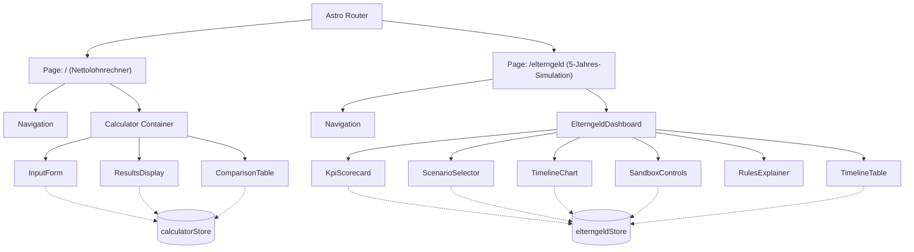

# Technical Architecture & Component Hierarchy

## 1. System Architecture Overview

The application is structured as a high-performance, reactive, static-first web application powered by **Astro 7** and **Preact**. All financial calculations, state management, tax modeling, and chart renderings run **100% client-side** in the browser with zero external network overhead and complete data privacy.

---

## 2. State Management Architecture

State is managed using **`@preact/signals`**, ensuring fine-grained, dependency-tracked reactive updates:

### Core Stores:
1. **`src/store/calculatorStore.js`**:
   - Manages gross income, tax brackets (I to VI), church tax flags, federal states (*Bundesländer*), number of children, and partner income parameters.
   - Computes German tax progression (§ 32a EStG), social security deduction caps, health care Zusatzbeitrag, care insurance child allowances, and solidarity surcharge.
   - Handles multi-scenario persistence via local storage.

2. **`src/store/elterngeldStore.js`**:
   - Manages household financial parameters (Husband Class III / Class V Net; Wife Full-time Class V / III Net; Wife Part-time Class V / III Net; Kindergeld).
   - Manages timeline signals: `prePregnancyPlanningMonths` (default 3M), `child1BirthMonth` (default 12M), `birthSpacingMonths` (default 27M), `swapLeadMonths` (default 7M).
   - Reactive computation functions:
     - `computeTimelineData('A')`: Baseline scenario with flat salaries.
     - `computeTimelineData('B')`: Unoptimized scenario with static Class III/V.
     - `computeTimelineData('C')`: Optimized scenario with proactive swaps, synthetic net rule, sibling bonus, and annual tax refunds.
   - Computes KPI metrics: Total Salaries, State Benefits Extracted, Tax Reconciliation Refund, Grand Total Inflow, and delta comparisons.

3. **`src/store/taxConfigStore.js`**:
   - Stores regulatory thresholds and statutory contribution rates (Health Cap, Pension Cap, Basic Allowance, Care Insurance rates).

---

## 3. UI Component Breakdown

### Navigation & Shell
- **`Navigation.jsx`**: Global sticky header providing route links between `/` and `/elterngeld`, active tab highlighting, brand identity, and statutory status indicator.

### Elterngeld Multi-Year Studio (`/elterngeld`)
- **`ElterngeldDashboard.jsx`**: Master layout coordinator.
- **`KpiScorecard.jsx`**: Displays 4 metric cards (`Total Earned Salaries`, `State Benefits Extracted`, `Finanzamt Tax Refund`, `Grand Total Household Inflow`) with scenario delta indicators.
- **`ScenarioSelector.jsx`**: Grid selector enabling instant switching between Scenario A, B, C, and the multi-scenario comparison overlay.
- **`TimelineChart.jsx`**: Custom responsive SVG chart engine:
  - **Stacked Bar Mode**: Renders 60 monthly stacked columns with distinct visual fills.
  - **Area Trend Mode**: Smooth stacked area paths illustrating cumulative household inflow trends.
  - **Compare Mode**: Overlay comparison curves of Scenario A vs. B vs. C with data points.
  - **Event Markers**: Visual pin markers for Pregnancy Starts, Tax Swaps, Births, and Sibling Bonus expiration.
  - **Hover Tooltip**: Interactive coordinate-tracked tooltip providing line-by-line monthly monetary composition.
- **`SandboxControls.jsx`**: Interactive range sliders and numerical inputs for all household parameters, birth spacing, and pre-pregnancy lead time with preset configurations.
- **`RulesExplainer.jsx`**: Interactive legal reference tabs detailing BEEG, MuSchG, EStG, and BFH rulings.
- **`TimelineTable.jsx`**: Comprehensive 60-month tabular ledger with year filters, search capabilities, delta toggles, and CSV data export.

---

## 4. Performance & Rendering Characteristics

- **Zero Runtime Dependencies**: The charting engine is built with native SVG math, avoiding heavy bundle footprints from third-party charting libraries.
- **Microsecond Signal Computations**: The 60-month cash flow calculation executes in < 2 milliseconds upon any slider movement.
- **Complete Isolation & Privacy**: No user financial data is transmitted to external servers or cloud endpoints.
