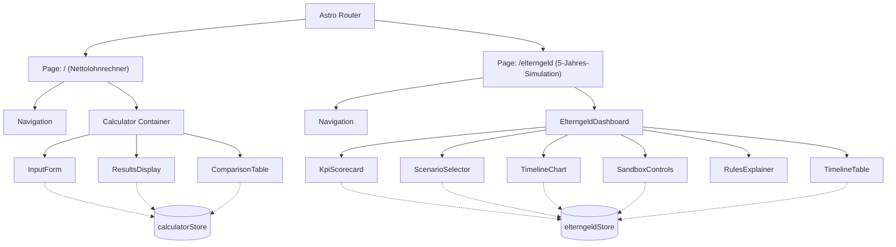

# Technical Architecture & Component Hierarchy

## 1. System Architecture Overview

The application is structured as a high-performance, reactive, static-first web application powered by **Astro 7** and **Preact**. All financial calculations, state management, tax modeling, and chart renderings run **100% client-side** in the browser with zero external network overhead and complete data privacy.



---

## 2. Calculation Engine & Strongly-Typed Domain Modeling (`src/engine/`)

The calculation engine is structured as a pure, deterministic, strongly-typed TypeScript core located in `src/engine/`. All financial calculations, timeline indices, tax classes, and statutory references are enforced with **Nominal / Branded Types** to guarantee compile-time safety:

### Nominal Branded Types (`src/engine/types.ts`):
```typescript
type Brand<K, T> = K & { readonly __brand: T };

export type SimulationMonth = Brand<number, 'SimulationMonth'>; // 1..60
export type CalendarYear = Brand<number, 'CalendarYear'>;       // 1..5
export type CalendarMonth = Brand<number, 'CalendarMonth'>;     // 1..12
export type WorkingHours = Brand<number, 'WorkingHours'>;       // 24, 32, 40

export type EuroAmount = Brand<number, 'EuroAmount'>;           // Exact EUR
export type EuroCents = Brand<number, 'EuroCents'>;             // Integer cents
export type GrossSalary = Brand<number, 'GrossSalary'>;         // Pre-tax gross
export type NetSalary = Brand<number, 'NetSalary'>;             // Post-withholding net

export type TaxClass = 'I' | 'II' | 'III' | 'IV' | 'V' | 'VI';
export type ScenarioId = 'A' | 'B' | 'C';
export type StatutoryCitation = Brand<string, 'StatutoryCitation'>;
export type TransactionId = Brand<string, 'TransactionId'>;
```

### Engine Submodules:
1. **`src/engine/tax/`**:
   - `wageTax.ts`: Monthly wage tax withholding (*Lohnsteuerabzug* § 38b EStG), Solidarity Surcharge (*Solidaritätszuschlag* § 32a EStG), and net wage determination per `TaxClass`.
   - `jointAssessment.ts`: Annual Joint Assessment with Income Splitting (*Ehegatten-Splitting* § 26b, § 32a Abs. 5 EStG), computing exact annual joint liability and wage tax prepayment reconciliations.
2. **`src/engine/benefits/`**:
   - `mutterschutz.ts`: Maternity pay (*Mutterschaftsgeld & Arbeitgeberzuschuss* § 19, 20 MuSchG).
   - `elterngeldAssessment.ts`: 12-Month pre-birth assessment baseline (*Bemessungszeitraum* § 2b BEEG) and statutory 7-month dominant tax class rule (*Überwiegende Steuerklasse* § 2b Abs. 1 Satz 3 BEEG).
   - `elterngeldPlus.ts`: Basiselterngeld & ElterngeldPlus (§ 4, 4a BEEG), sliding scale replacement rates (65%–100% § 2 BEEG), statutory caps (€900 / €1,800) and floors (€150 / €300).
   - `siblingBonus.ts`: Sibling bonus (*Geschwisterbonus* § 2a BEEG +10%, min. +€75 for ElterngeldPlus) until Child 1 reaches 36 months.
   - `kindergeld.ts`: Statutory child benefit (*Kindergeld* § 66 EStG) per child.
3. **`src/engine/ledger/`**:
   - `transaction.ts`: Atomic financial ledger entry with unique `TransactionId`, `SimulationMonth`, signed `EuroAmount`, legal `StatutoryCitation`, and mathematical audit trail.
   - `ledger.ts`: 60-Month double-entry accounting ledger aggregating monthly sub-accounts, running totals, and annual reconciliation audits.
4. **`src/engine/simulator/`**:
   - `timelineGenerator.ts`: Pure deterministic multi-year timeline simulator generating 60-month ledgers for Scenarios A, B, and C with full branded-type safety.

---

## 3. State Management Architecture

State is managed using **`@preact/signals`**, ensuring fine-grained, dependency-tracked reactive updates connecting the TypeScript engine to the UI:

### Core Stores:
1. **`src/store/calculatorStore.js`**:
   - Manages gross income, tax brackets (I to VI), church tax flags, federal states (*Bundesländer*), number of children, and partner income parameters.
   - Computes German tax progression (§ 32a EStG), social security deduction caps, health care Zusatzbeitrag, care insurance child allowances, and solidarity surcharge.
   - Handles multi-scenario persistence via local storage.

2. **`src/store/elterngeldStore.js`**:
   - Manages household financial parameters (Husband Class III / Class V Net; Wife Full-time Class V / III Net; Wife Part-time Class V / III Net; Kindergeld).
   - Manages timeline signals: `prePregnancyPlanningMonths` (default 3M), `child1BirthMonth` (default 12M), `birthSpacingMonths` (default 27M), `swapLeadMonths` (default 7M).
   - Reactive computation functions invoking `timelineGenerator.ts`:
     - `computeTimelineData('A')`: Baseline scenario with flat salaries.
     - `computeTimelineData('B')`: Unoptimized scenario with static Class III/V.
     - `computeTimelineData('C')`: Optimized scenario with proactive swaps, synthetic net rule, sibling bonus, and annual tax refunds.
   - Computes KPI metrics: Total Salaries, State Benefits Extracted, Tax Reconciliation Refund, Grand Total Inflow, and delta comparisons.

3. **`src/store/taxConfigStore.js`**:
   - Stores regulatory thresholds and statutory contribution rates (Health Cap, Pension Cap, Basic Allowance, Care Insurance rates).

---

## 3. UI Component Breakdown

### Navigation & Shell
- **`Navigation.jsx`**: Global sticky header providing route links between `/` and `/elterngeld`, active tab highlighting, brand identity, and statutory status indicator.

### Elterngeld Multi-Year Studio (`/elterngeld`)
- **`ElterngeldDashboard.jsx`**: Master layout coordinator.
- **`KpiScorecard.jsx`**: Displays 4 metric cards (`Total Earned Salaries`, `State Benefits Extracted`, `Finanzamt Tax Refund`, `Grand Total Household Inflow`) with scenario delta indicators.
- **`ScenarioSelector.jsx`**: Grid selector enabling instant switching between Scenario A, B, C, and the multi-scenario comparison overlay.
- **`TimelineChart.jsx`**: Custom responsive SVG chart engine:
  - **Stacked Bar Mode**: Renders 60 monthly stacked columns with distinct visual fills.
  - **Area Trend Mode**: Smooth stacked area paths illustrating cumulative household inflow trends.
  - **Compare Mode**: Overlay comparison curves of Scenario A vs. B vs. C with data points.
  - **Event Markers**: Visual pin markers for Pregnancy Starts, Tax Swaps, Births, and Sibling Bonus expiration.
  - **Hover Tooltip**: Interactive coordinate-tracked tooltip providing line-by-line monthly monetary composition.
- **`SandboxControls.jsx`**: Interactive range sliders and numerical inputs for all household parameters, birth spacing, and pre-pregnancy lead time with preset configurations.
- **`RulesExplainer.jsx`**: Interactive legal reference tabs detailing BEEG, MuSchG, EStG, and BFH rulings.
- **`TimelineTable.jsx`**: Comprehensive 60-month tabular ledger with year filters, search capabilities, delta toggles, and CSV data export.

---

## 4. Performance & Rendering Characteristics

- **Zero Runtime Dependencies**: The charting engine is built with native SVG math, avoiding heavy bundle footprints from third-party charting libraries.
- **Microsecond Signal Computations**: The 60-month cash flow calculation executes in < 2 milliseconds upon any slider movement.
- **Complete Isolation & Privacy**: No user financial data is transmitted to external servers or cloud endpoints.

---

## 5. Testing Platform Architecture (Domain-Driven Hybrid)

The repository employs a **Domain-Driven Hybrid Testing Strategy** that balances unit-level cohesion with cross-cutting scenario scalability:

```
├── src/                                  # 1:1 Co-located Unit & Logic Tests
│   ├── engine/
│   │   ├── tax/
│   │   │   ├── wageTax.ts
│   │   │   ├── wageTax.test.ts          # Pure unit tests adjacent to source
│   │   │   ├── jointAssessment.ts
│   │   │   └── jointAssessment.test.ts  # Pure unit tests adjacent to source
│   │   ├── benefits/
│   │   │   ├── elterngeldPlus.ts
│   │   │   └── elterngeldPlus.test.ts   # Pure unit tests adjacent to source
│   │   └── simulator/
│   │       ├── timelineGenerator.ts
│   │       └── actions.test.ts          # Action batch execution unit tests
│   └── cli/
│       ├── runner.ts
│       └── runner.test.ts               # CLI runner unit tests
│
└── test/                                 # Dedicated Cross-Cutting Suites
    ├── scenario/                        # 60-Month multi-year Scenario A/B/C lifecycles
    ├── combination/                     # Combinatorial parameter grid sweeps
    ├── benchmark/                       # High-throughput calculation benchmarks
    └── fixture/                         # Shared statutory test data & standard households
```

### Test Suite Execution Matrix:
- `npm run test`: Master runner across all `src/**/*.test.ts` and `test/**/*.test.ts`.
- `npm run test:unit`: In-source 1:1 unit tests.
- `npm run test:scenario`: 60-Month multi-year lifecycle simulation assertions.
- `npm run test:combination`: 180-permutation combinatorial slider sweeps.
- `npm run test:benchmark`: Microsecond throughput and calculation speed metrics.

