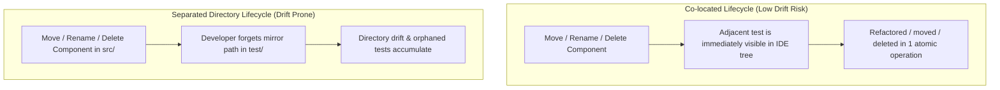
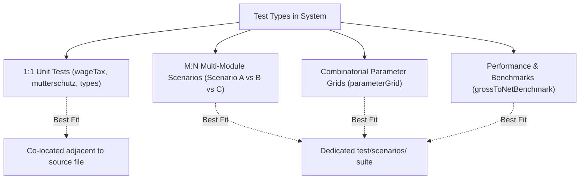

# Test Organization Strategy: Co-location vs. Dedicated Test Directory

An architectural evaluation of test file placement strategies for the **lucid-hertz** repository, comparing **Co-located In-Source Tests** (`src/**/*.test.ts`) against a **Dedicated Test Directory** (`test/**`), as well as the **Domain-Driven Hybrid Model**.

---

## 1. Overview of the Architectural Models

| Model | Structural Pattern | Primary Philosophy |
| :--- | :--- | :--- |
| **Model A: Co-location (In-Source)** | Tests live in the same directory adjacent to their implementation (`src/engine/tax/wageTax.ts` $\leftrightarrow$ `src/engine/tax/wageTax.test.ts`). | **High Cohesion & Proximity**: Code and its immediate unit verification are parts of the same cohesive module. |
| **Model B: Dedicated Test Directory** | Tests are isolated in a root-level `test/` tree mirroring or categorizing test types (`test/unit/tax/wageTax.test.ts`, `test/scenarios/...`). | **Strict Boundary & Production Purity**: Production source code is cleanly segregated from test infrastructure and fixtures. |
| **Model C: Domain-Driven Hybrid** | 1:1 Unit tests are co-located in `src/`, while cross-cutting scenarios, parameter grids, and benchmarks reside in `test/`. | **Pragmatic Pragmatism**: Maximizes unit test proximity while preserving dedicated spaces for M:N integration tests. |

---

## 2. In-Depth Multi-Dimensional Comparison

### A. Maintainability & Refactoring Lifecycle



1. **Refactoring Safety & Atomic File Moves**:
   - **Co-location (Winner for Unit Tests)**: When moving, renaming, or deleting a component or engine file (e.g. `src/engine/benefits/siblingBonus.ts`), the corresponding test `siblingBonus.test.ts` is right beside it. Modern IDE refactoring tools move adjacent files or prompt developers immediately.
   - **Dedicated Folder**: High risk of **directory drift**. When `src/` is refactored, the parallel tree in `test/` often lags behind.
     - *Evidence in Current Repo*: `src/engine/storage/exportImport.ts` is placed at `src/engine/storage/`, but its test is located at `test/unit/storage/exportImport.test.ts` (missing the `engine/` nesting level). This is a classic example of structure drift.

2. **Dead Code & Orphaned Test Detection**:
   - **Co-location**: If a source file is removed, an orphaned test stands out immediately in the folder.
   - **Dedicated Folder**: When deleting a feature in `src/`, developers frequently forget to delete tests in `test/`, leading to "zombie tests" that test dead abstractions or mock obsolete interfaces.

---

### B. Scalability & Test Taxonomy



1. **Handling 1:1 Unit Verification**:
   - Co-location excels when every unit has a distinct companion test (`mutterschutz.ts` $\rightarrow$ `mutterschutz.test.ts`).
2. **Handling Multi-Module Scenarios & Integration Tests**:
   - **Co-location Fails Here**: Where does `test/scenarios/simulationMatrix.granular.test.ts` or `test/combinations/parameterGrid.test.ts` live? They exercise `wageTax`, `jointAssessment`, `elterngeldPlus`, `mutterschutz`, `timelineGenerator`, and `ledger` simultaneously. Placing them inside `src/engine/tax/` or `src/engine/simulator/` is arbitrary and breaks modular boundaries.
   - **Dedicated Folder Excels Here**: A dedicated `test/` hierarchy naturally houses tests categorized by level of abstraction (`test/unit/`, `test/scenarios/`, `test/combinations/`, `test/benchmarks/`, `test/e2e/`).

---

### C. Developer Ergonomics & Cognitive Load

| Dimension | Co-located (`src/`) | Dedicated Folder (`test/`) |
| :--- | :--- | :--- |
| **Discoverability** | Instant. Opening a file immediately shows whether tests exist and what is covered. | Requires navigating across two separate trees in the file explorer. |
| **Tree Clutter** | Doubles the number of files in `src/` folders (e.g. 10 files becomes 20). | Keeps `src/` clean, showing only runtime production files. |
| **Context Switching** | Minimal. Working on a component and its test requires zero jumping between root folders. | High. Modifying `src/engine/tax/` requires scrolling to `test/unit/tax/`. |
| **Import Path Brevity** | Unit test imports implementation using `./wageTax.js` (clean relative import). | Unit test must use `#engine/tax/wageTax.js` or `../../../src/engine/tax/wageTax.js`. |

---

### D. Tooling, Bundling & Framework Alignment

1. **Astro 7 & Static Build Pipeline**:
   - Astro processes pages under `src/pages/`. Co-locating tests inside `src/pages/` (e.g., `src/pages/index.test.ts`) must be avoided or guarded so Astro's page router does not interpret them as routes.
   - For `src/engine/` and `src/components/`, Astro and Vite ignore `*.test.ts` during production bundle compilation (`astro build`) unless explicitly imported.
2. **Node Native Test Runner (`node --test`)**:
   - Node's native test runner accepts glob patterns seamlessly:
     - Current: `node --test 'test/**/*.test.ts'`
     - Co-located: `node --test 'src/**/*.test.ts'`
     - Hybrid: `node --test 'src/**/*.test.ts' 'test/**/*.test.ts'`
3. **Automated Quality Audits & Static Scanners**:
   - Quality audit scripts like `src/cli/qualityAudit.ts` and Prettier format checks (`npm run check:format`) can target both `src/` and `test/` without overhead.

---

## 3. Comprehensive Pros and Cons Matrix

### Model A: Co-located Tests (`src/**/*.test.ts`)

#### Advantages
- **Immediate Proximity**: Writing tests feels like part of writing code, encouraging Test-Driven Development (TDD).
- **Zero Structure Drift**: Moving or renaming a source directory automatically carries tests with it.
- **Natural Boundary Enforcement**: Private or internal helpers in a file or sub-package can be tested directly without exposing them globally.
- **Instant Coverage Awareness**: A missing `*.test.ts` file in a directory is immediately visible.

#### Drawbacks
- **File Tree Density**: Folder views in IDEs become twice as dense.
- **Unclear Home for System Tests**: Cannot cleanly accommodate end-to-end, multi-file integration, or cross-cutting scenario suites.
- **Risk of Accidental Packaging**: If build tool excludes are misconfigured, test utilities or fixtures might be bundled into production.

---

### Model B: Dedicated Test Directory (`test/**`)

#### Advantages
- **Clean Source Directory**: `src/` strictly contains shipping production code.
- **Categorized Test Taxonomy**: Allows natural organization by test scope (`test/unit/`, `test/integration/`, `test/scenarios/`, `test/e2e/`, `test/performance/`).
- **Shared Test Helpers & Mock Fixtures**: Dedicated space for shared test harness code (`test/fixtures/`, `test/mocks/`) without polluting production source.

#### Drawbacks
- **Structural Mirroring Drift**: As the codebase evolves, directory hierarchies between `src/` and `test/` diverge.
- **Higher Cognitive Load**: Developers must maintain two open folder trees and use longer import specifiers.
- **Orphaned Test Accumulation**: Deleted source files frequently leave abandoned test files behind in `test/`.

---

## 4. Architectural Recommendation for `lucid-hertz`

For a high-precision financial calculator and simulation engine with both **pure deterministic mathematical units** and **complex multi-year scenario matrices**, the optimal architecture is the **Domain-Driven Hybrid Model**:

1. **Co-locate Pure Unit & Component Tests (`src/**/__tests__/` or `src/**/*.test.ts`)**:
   - Engine modules: `src/engine/tax/wageTax.test.ts`, `src/engine/benefits/elterngeldPlus.test.ts`, `src/engine/ledger/ledger.test.ts`.
   - UI components: `src/components/elterngeld/KpiScorecard.test.tsx`.
   - *Rationale*: Eliminates structure drift in the core engine and ensures 100% test proximity during domain logic development.

2. **Keep Multi-Scenario, Combinatorial, and System Suites in `test/`**:
   - `test/scenarios/`: Multi-year 60-month lifecycle matrix tests (Scenario A, B, C).
   - `test/combinations/`: Parameter grid searches and Monte Carlo stress tests.
   - `test/benchmarks/`: Performance benchmarks and execution timing.
   - `test/fixtures/`: Shared statutory test fixtures, sample tax declarations, and mock payloads.

3. **Unified Runner Configuration**:
   - Update `package.json` test script to:
     ```json
     "test": "ASTRO_TELEMETRY_DISABLED=1 DO_NOT_TRACK=1 node --test 'src/**/*.test.ts' 'test/**/*.test.ts'"
     ```
