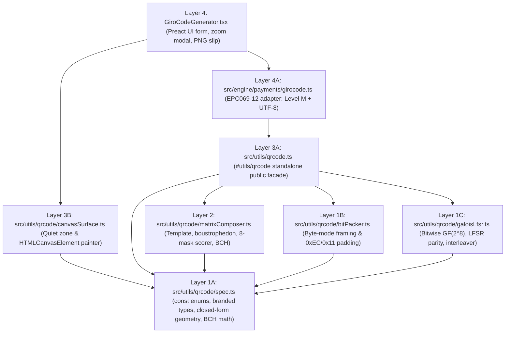

# Cleanroom First-Principles QR Code Library Architecture

**Date:** 2026-11-15  
**Status:** Cleanroom architectural blueprint; specification-driven design only.

---

## 1. Scope & Cleanroom Design Principles

This architecture specifies an original, zero-dependency QR Code library designed from first principles directly from **ISO/IEC 18004 (QR Code Model 2)** and **EPC069-12 V002** (SEPA Credit Transfer Quick Response Code):

- **Minimal Functional Scope**:
  - **Encoding Mode**: 8-bit Byte mode (`0b0100`) over raw UTF-8 bytes (`TextEncoder`).
  - **Error Correction**: Level `M` (~15% codeword recovery).
  - **Version Range**: Versions `1..13` (`21×21` through `69×69` modules). At Version 13 Level `M` (`334` data codewords = `2,672` bits), Byte mode (`4`-bit mode + `16`-bit byte count + `331 × 8` payload bits + `4`-bit `0000` terminator = `2,672` bits) accommodates the exact `331`-byte EPC069-12 maximum payload.
- **Rechner Engineering Standards**:
  - Nominal branded types (`Brand<K, T>`), `const` object enums with runtime type guards, immutable data structures, pure stateless functions, and explicit `TypeError` / `RangeError` validation at boundaries.

---

## 2. Mathematical & Algorithmic Design (~260–320 Lines Total)

1. **Closed-Form Symbol Geometry**
   - Grid dimension is `N = 4 * version + 17`.
   - Alignment track coordinates for Versions `1..13` are computed directly from `N` without lookup tables:
     - `version === 1`: `[]`
     - `2 <= version <= 6`: `[6, N - 7]`
     - `7 <= version <= 13`: `[6, (N - 1) / 2, N - 7]` (exact even midpoint matching ISO/IEC 18004 Annex E).
   - Total codeword capacity equals `Math.floor(unreservedCells / 8)` from symbol geometry, reducing Version `1..13` Level `M` block parameters to two 13-byte arrays:
     - `EC_BYTES_PER_BLOCK_M = [10, 16, 26, 18, 24, 16, 18, 22, 22, 26, 30, 22, 22]`
     - `BLOCK_COUNT_M = [1, 1, 1, 2, 2, 4, 4, 4, 5, 5, 5, 8, 9]`
     - Short and long block counts follow directly from integer division and remainder (`totalDataBytes = totalCodewords - blockCount * ecBytes`; `longBlockCount = totalDataBytes % blockCount`, placed in the trailing blocks per ISO/IEC 18004).

2. **Bitwise `GF(2^8)` Carryless Multiply & Linear Feedback Shift Register (LFSR)**
   - Carryless multiplication modulo irreducible polynomial `0x11D` (`x^8 + x^4 + x^3 + x^2 + 1`) runs in 8 bit-shift/XOR iterations without log/antilog lookup tables.
   - A flat `Uint8Array` shift register computes Reed–Solomon parity bytes per block, followed by two-group data and parity interleaving.

3. **Single-Pass Structural Template on Flat `Uint8Array` Planes**
   - Two flat `Uint8Array(N * N)` buffers (`reserved` for function patterns and metadata slots, `modules` for light `0` / dark `1` polarity) stamp the three `7×7` finders, `1`-module light separators, row/column `6` timing tracks, `5×5` alignment squares, fixed dark module `(N - 8, 8)`, and format/version slot reservations once.
   - Mask candidates `0..7` clone and XOR only unreserved payload modules without rebuilding function patterns.

4. **11-Bit Sliding-Window Penalty Scorer**
   - Evaluates ISO/IEC 18004 mask rules N1 (runs `>= 5`), N2 (`2×2` blocks), N3 (`1:1:3:1:1` finder-like ratio with 4-module light guard via a rolling 11-bit window matching `0b10111010000` and `0b00001011101`), and N4 (dark/light balance around `50%`).

---

## 3. Four-Layer Standalone Architecture

Rechner maps `"#utils/*": "./src/utils/*.ts"` in `package.json` and `tsconfig.json`. Matching `src/utils/zip.ts` (`#utils/zip`), the QR subsystem separates math primitives, matrix composition, standalone library/canvas surfaces, and SEPA/UI consumers into four strict one-way layers:

| Layer | File(s) & Alias | Responsibility | Architectural Boundary |
| :--- | :--- | :--- | :--- |
| **Layer 1: Specification Math & Primitives** | `src/utils/qrcode/spec.ts` `src/utils/qrcode/bitPacker.ts` `src/utils/qrcode/galoisLfsr.ts` | `const` enums (`QrErrorCorrection`, `QrMaskId`) + runtime guards; branded `QrVersion`, `QrGridSize`, `QrModuleScale`, `QrQuietZone`; closed-form geometry & capacity; `BCH(15,5)` (`0x537` XOR `0x5412`, `M = 0b00`) & `BCH(18,6)` (`0x1F25`); Byte-mode framing (`0b0100`); bitwise `gfMultiply`, LFSR RS parity, and two-group interleaving. | Pure TypeScript; zero DOM, browser, or payment imports. |
| **Layer 2: Symbol Matrix Composer** | `src/utils/qrcode/matrixComposer.ts` | Stamps structural template once, writes interleaved bits in 2-column boustrophedon order (skipping timing col `6`), selects lowest-penalty mask `0..7`, stamps BCH format/version metadata, and returns immutable `QrSymbolMatrix`. | Pure deterministic matrix synthesis; zero UI or SEPA knowledge. |
| **Layer 3: Standalone Public Facade & Raster Surface** | `src/utils/qrcode.ts` (`#utils/qrcode`) `src/utils/qrcode/canvasSurface.ts` (`#utils/qrcode/canvasSurface`) | Domain-agnostic `encodeQrUtf8` and `encodeQrBytes` API returning `QrSymbolMatrix`, paired with `paintQrSymbolToCanvas(canvas, matrix, options?)` handling quiet zone (`default 4`), module scale, and `<canvas>` painting with caller-supplied light/dark colors. | Reusable across any future calculator or export tool; keeps `.tsx` color token compliance intact. |
| **Layer 4: Domain & UI Consumers** | `src/engine/payments/girocode.ts` `src/apps/girocode/GiroCodeGenerator.tsx` | `createGiroCodeQrMatrix(payload: EpcPayload)` delegates to `encodeQrUtf8` with `QrErrorCorrection.M`. `GiroCodeGenerator.tsx` calls `paintQrSymbolToCanvas` for inline preview and zoom modal. | `girocode.ts` remains a pure SEPA adapter with zero external QR dependencies; `GiroCodeGenerator.tsx` contains zero QR math or module-drawing loops. |

---

## 4. Specification-Based Self-Verification

All tests verify compliance strictly through algebraic properties and ISO/IEC 18004 rules:

1. **Algebraic Reed–Solomon Zero-Syndrome Proof (`galoisLfsr.test.ts`)**
   - Evaluate every generated block `[...dataBytes, ...parityBytes]` over `GF(2^8)` at all generator roots `alpha^0 .. alpha^(ecBytes - 1)` and assert every syndrome equals `0`.
   - Assert exact short/long block counts and interleaved codeword lengths across Versions `1..13` Level `M`.

2. **ISO/IEC 18004 Reference Vectors & Capacity Transitions (`spec.test.ts`, `bitPacker.test.ts`)**
   - Verify BCH reference outputs: `0x5412` for Level `M` (`0b00`) + Mask `0` (`0b000`), and `0x07C94` for Version `7` 18-bit version info.
   - Verify exact byte-capacity boundaries:
     - `106` bytes -> Version `6` (`41×41`); `107` bytes -> Version `7` (`45×45`, enabling 18-bit version info)
     - `180` bytes -> Version `9` (`53×53`); `181` bytes -> Version `10` (`57×57`, switching byte count from 8 to 16 bits)
     - `331` bytes -> Version `13` (`69×69`, exact EPC069-12 ceiling)
     - `332+` bytes -> throws typed `RangeError`.

3. **Self-Contained Round-Trip Matrix Unmask & Decode Test (`qrcode.test.ts`)**
   - A compact test-only reader inspects the emitted `QrSymbolMatrix`, validates finder/separator/timing/alignment/dark-module invariants, decodes and verifies the 15-bit `BCH(15,5)` format header (and 18-bit `BCH(18,6)` version blocks for `V >= 7`), unmasks boustrophedon payload cells, de-interleaves blocks, confirms zero Reed–Solomon syndromes, and decodes the UTF-8 Byte stream back to the exact input string across ASCII, German UTF-8 (`äöü߀`), and full `331`-byte EPC069-12 payloads.
